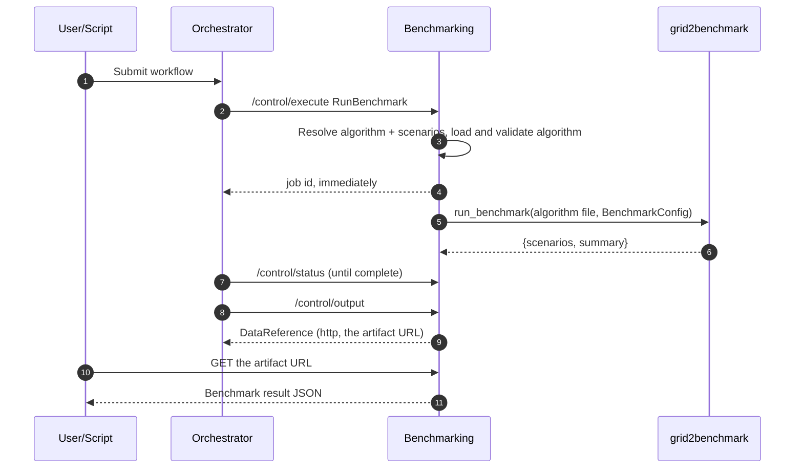

# Dutch Node Benchmarking Use Case (Grid2Benchmark)

A standalone benchmark service for network topology optimization algorithms.
It runs an algorithm against grid2op scenarios with the
[grid2benchmark](https://github.com/paulban/grid2benchmark) package and returns
grid2benchmark's result as a JSON artifact. It does not consume data from the
data synthesizer.

**Spec:** `.claude/specs/dutch-node-target-architecture-spec.md` (FR-24 to FR-28)

## What a request selects

A request names its inputs; it never carries code or file paths. Both come from
directories on the node that the operator fills:

| Input | Selected from | Bind-mounted at |
|---|---|---|
| Algorithm: a `.py` file implementing `build_agent(env, context)` | `algorithms/` | `/app/algorithms` (read-only) |
| Scenario: a grid2op environment directory | `scenarios/` | `/app/scenarios` (read-only) |

A scenario name with no directory in `scenarios/` is passed to grid2op as a
built-in environment, such as `l2rpn_case14_sandbox`. Both directories are
bind-mounted, so a new algorithm or scenario needs no image rebuild. The image
ships `algorithms/algorithm_template.py`, a no-op baseline and the default.

Names are checked to be bare file or directory names, so a request cannot point
the service anywhere else. The algorithm still runs inside the service process
with no sandbox; only place code there that you trust.

## How a run works



Jobs run through `BatchJobRunner` from `use-cases/common/batch_jobs.py`: the job
id is returned immediately (FR-24), the result is served at
`/control/data/{job_id}` and referenced from `/control/output` (FR-05, FR-25),
and simultaneous runs are capped (FR-26). A submission beyond the cap fails
immediately.

## Input payload

Inline base64 JSON. Every field is optional; omitted values take
grid2benchmark's defaults.

```json
{
  "algorithm": "algorithm_template.py",
  "benchmark": {
    "max_steps": 100,
    "kpis": ["carbon_intensity", "operation_score", "topological_action_complexity"],
    "scenarios": [
      {"env_name": "l2rpn_case14_sandbox", "time_series_ids": [0]},
      {"env_name": "my_dumped_scenario", "backend": "lightsim2grid"}
    ]
  }
}
```

- `env_name`: a directory in `scenarios/` or a grid2op built-in environment.
- `time_series_ids`: which time series to run; all available when omitted.
- `backend`: `pandapower`, `lightsim2grid` or `pypowsybl`.
- `kpis`: by default grid2benchmark computes `carbon_intensity`,
  `operation_score` and `topological_action_complexity`. It also accepts the
  opt-in `network_utilization` (N-1) and `assistant_alert_accuracy`, and
  rejects the run on any other name.
- `network_utilization` has a known bug in grid2evaluate, so do not rely on its
  values. It fails on grids whose element names differ between grid2op and the
  pypowsybl conversion (such as `l2rpn_case14_sandbox`). With the pyarrow 19
  this image installs, it skips every time step, so the N-1 values come out as
  0. A request selecting it still runs: the warning is logged, stored in
  `metadata.warnings`, and appended to the error if the run fails.
- For a single scenario, its fields may sit directly in the `benchmark` block.

grid2benchmark validates all values; a rejected request fails immediately with
its error message.

## Output shape

The artifact is `run_benchmark`'s result unchanged, plus `metadata`:

| Field | Contents |
|---|---|
| `scenarios[]` | Per scenario: `environment`, `executed_time_series_ids`, `episodes` (steps, overloads, runtime per time series), `kpis` |
| `summary` | Cross-scenario aggregates computed by grid2benchmark |
| `metadata` | `algorithm` file name, `grid2benchmark_version`, `grid2op_version`, `warnings` (known issues of the selected KPIs, empty when none) |

## Running it

```bash
export SERVICE_API_KEY=$(openssl rand -hex 32)   # optional; open if unset

cd orchestrator && docker compose up -d          # api, redis, 3 workers
cd ../use-cases/dutch-node-benchmarking && docker compose up -d --build
```

`scripts/start.sh` and `scripts/stop.sh` wrap those two lines.

The orchestrator's workers dial the service on the `ai-effect-services` network
at the address `export/dockerinfo.json` names, `benchmark-runner:8080`. The
compose file also publishes it on loopback at `http://localhost:8004`; result
references point there by default, so a finished benchmark is fetchable from
this machine. That host port is a development convenience that FR-19 and FR-27
do not permit in a deployment, where `BENCHMARK_SELF_URL` names the node's proxy
route instead and the `ports:` block is dropped.

| Variable | Default | Purpose |
|---|---|---|
| `BENCHMARK_HOST_PORT` | `8004` | Loopback port the service is published on |
| `BENCHMARK_SELF_URL` | `http://localhost:8004` | Base URL result references are built from |
| `SERVICE_API_KEY` | unset | Bearer token on `/control/*`; open if unset |
| `BENCHMARK_MAX_CONCURRENT_JOBS` | `1` | Simultaneous benchmark runs |
| `BENCHMARK_CPU_LIMIT` / `BENCHMARK_MEMORY_LIMIT` | `2.0` / `4G` | Resource ceiling |

## Run a benchmark through the orchestrator

```bash
SERVICE_API_KEY=<same key> ./run_workflow.sh
```

`../../submit-workflow.sh` at the use case root runs the same script. It
submits the exported blueprint, waits for the workflow, fetches the result the
reference points at, and prints a summary. It checks first that the
orchestrator is up, that its workers are running, and that the service answers
at its `dockerinfo.json` address *from inside a worker*.

| Variable | Default | Purpose |
|---|---|---|
| `ORCHESTRATOR_URL` | `http://localhost:18000` | Where to submit |
| `ORCHESTRATOR_API_KEY` | unset | Bearer token on the orchestrator API |
| `SERVICE_API_KEY` | unset | Forwarded to the service as `services_api_key`. Must match the container's, or the worker's call is rejected with 401 |
| `ALGORITHM` | `algorithm_template.py` | Algorithm file name in `algorithms/` |
| `SCENARIO` | `l2rpn_case14_sandbox` | Scenario directory in `scenarios/` or grid2op built-in |
| `TIME_SERIES_IDS` | `0` | Comma-separated time series to run |
| `MAX_STEPS` | `100` | Steps per episode |
| `KPIS` | all three | Comma-separated KPI names |
| `OUTPUT_DIR` | `./results` | Where the fetched result is written |

## Key files

- `service.py` — the service: `RunBenchmark`, request handling, the call into
  grid2benchmark, and the batch job submission. Laid out like the onboarding
  templates in `use-cases/templates/`
- `handler.py` — re-exports the shared control plane from `use-cases/common/`
- `algorithms/` — algorithm files a request can select
- `scenarios/` — grid2op scenario directories a request can select
- `proto/benchmarking.proto` — declares the `RunBenchmark` operation for the
  onboarding export. The service itself speaks HTTP, not gRPC
- `../../export/` — orchestrator workflow metadata, generated with
  `python scripts/onboarding-export-generator.py use-cases/dutch-node-benchmarking <out>`
  from the proto and `../../connections.json`. The generator names the
  container `benchmarking1`
- `run_workflow.sh` — end-to-end orchestration run script

## Tests

```bash
python -m pytest use-cases/dutch-node-benchmarking/services/benchmarking/tests/ -q
```

The unit tests need `grid2benchmark` installed, since they use its config
classes for real. `tests/test_batch_execution.py` covers the shared job
lifecycle in `use-cases/common/`.

## Notes on dependencies

- `grid2benchmark` (branch `main`), `grid2evaluate` and grid2op's
  `env_recorder` branch are installed from GitHub; none of them is pinned to a
  commit. Docker's layer cache can therefore keep an older commit; rebuild with
  `docker compose build --no-cache benchmark-runner` to pick up new ones.
- The Dockerfile installs `pyarrow==19.0.1` over the `pyarrow>=20` that
  `grid2evaluate` declares. grid2op's `EnvRecorder`, which records every run,
  needs pyarrow; pyarrow 20 and later only import with NumPy 2, while
  `pypowsybl2grid` pins `numpy==1.26.4`. pip reports the conflict at build
  time; it is deliberate.
- `torch` is an optional extra of grid2benchmark (`grid2benchmark[torch]`) and
  is not installed. Its CUDA build made the image about 10 GB.
